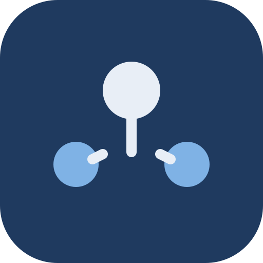
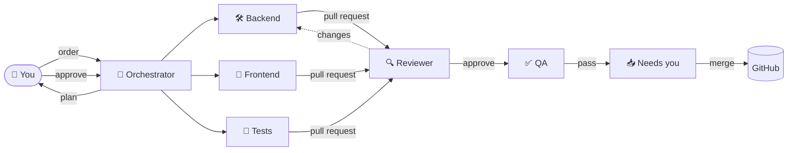

<div align="center">



# Agent Office

**A dev team of Claude Code agents you run from your phone.**

You give the order. They plan, build, review and test it as pull requests. You tap merge.

[](LICENSE)
[](https://nodejs.org)
[](https://claude.com/claude-code)
[](#-phone-access)
[](#-platform)

<!-- Owner: replace with the GIF cut from the launch reel. -->


</div>

---

## ✨ How it works

<table>
<tr>
<td align="center" width="20%"><br /><b>1. Bring a repo</b></td>
<td align="center" width="20%"><br /><b>2. Approve the plan</b></td>
<td align="center" width="20%"><br /><b>3. Agents build</b></td>
<td align="center" width="20%"><br /><b>4. Review and QA</b></td>
<td align="center" width="20%"><br /><b>5. You merge</b></td>
</tr>
<tr valign="top">
<td>A GitHub repo, a folder, or a blank folder with a product brief. The Onboarding agent interviews you and proposes your office.</td>
<td>Tell the Orchestrator what you want. It splits the work into tasks with dependencies. Approve, edit or reject.</td>
<td>Specialists work in parallel, each in its own git worktree, in real Claude Code terminals you can watch and take over.</td>
<td>A Reviewer and a QA agent check every PR. Failures go back to the author with notes.</td>
<td>Ready PRs land in <i>Needs you</i>. One tap merges each, from anywhere.</td>
</tr>
</table>



## 🏢 More than a dev team

Tech is always open. Add floors as you need them. Each floor has its own lead, workers and reviewer, writes Markdown under its own folder, and ships PRs the same way code does.

| Floor | What it makes |
|---|---|
| 🧡 **Tech** | The product: code, tests, specs |
| 💜 **Design** | UX flows, wireframes, UI specs, HTML mockups, design tokens |
| 💙 **Docs** | User guides, help center, API reference, changelogs |
| 💛 **Marketing** | Positioning, website copy, blog posts, launch drafts |
| 💚 **Sales** | Ideal customer profile, pitch, outreach drafts |
| 🩵 **Customer** | Onboarding guides, FAQ, support replies |
| ❤️ **Legal** | Terms, privacy policy, compliance checklists (all drafts) |
| 🤎 **Ops & Finance** | Runway and pricing models, budgets, processes |
| 🍏 **Research** | Market and competitor research, interview synthesis |

Plus a **Support desk**  for chores: run the tests, start a dev server, query a database. No plan, no PR.

## 📱 What you see

<table>
<tr>
<td width="50%" valign="top">

**🏠 Office.** Every agent at a desk, animated by what it is doing right now. Tap one to open its live terminal.

**💬 Command.** Chat with each floor's lead. Plans arrive as cards.

**📋 Board.** Kanban of every task, from planned to merged.

</td>
<td width="50%" valign="top">

**🙋 Needs you.** Plans to approve, permission prompts, questions and PRs to merge.

**👥 Team.** Hire, pause or remove agents; pick each one's model and effort.

**🗂️ Vault.** Notes and decisions the whole team can search.

</td>
</tr>
</table>

Agents also talk to each other: they pass notes, ask the lead questions, and ask you only when the answer changes scope.

<p align="center">


</p>

## 🚀 Quickstart

You need:

| | |
|---|---|
| **Node 24** | uses the built-in `node:sqlite` |
| **git** | |
| **Claude Code** | logged in. Terminal runs need the native `claude.exe` (or `claude`) on `PATH` from the native installer. With an npm install, set `CREW_CLAUDE_PTY_BIN` to a runnable path, or `CREW_TERMINAL=json` to run headless. |
| **GitHub CLI** | `gh`, logged in with the `repo` scope |
| **A computer that stays on** | agents run on your machine, not in the cloud |

```bash
git clone https://github.com/DewashishCodes/agent-office.git
cd agent-office
cp .env.example .env      # set OWNER_TOKEN to a long random string
npm install
npm run build && npm start
```

Open **http://localhost:5190**, log in with your `OWNER_TOKEN`, and add a project. All state lives in `data/`; delete it to start over.

## 📲 Phone access

Use [Tailscale Serve](https://tailscale.com/kb/1312/serve) for HTTPS inside your private tailnet:

```bash
tailscale serve --bg 5190
```

Open `https://<machine>.<tailnet>.ts.net` on your phone (Tailscale app connected), log in, then **Add to Home Screen** to install the app and turn on push notifications.

> [!CAUTION]
> Never expose port 5190 to the open internet: no port forwarding, no public tunnels. Anyone who gets in can run commands on your computer through the agents.

## 🔒 Security

> [!WARNING]
> Agents run real commands on your machine with your git and GitHub credentials. Read this before you start.

| | |
|---|---|
| 🙋 **Approvals** | Agents edit files in their own worktree freely. Shell commands outside a safe list and file access outside the worktree ask you first. Unanswered requests are denied after 15 minutes. |
| 🚫 **Deny rules** | Always on: no `git push`, no `gh`, no `.env`, nothing under protected paths (`.env*`, keys, `secrets/`, `.github/workflows/`, `migrations/`). The server does the pushing. |
| 📁 **Owned paths** | After each task, a gate checks every changed file against the agent's owned paths and sends the task back if anything is outside. |
| 🔀 **Merges are yours** | Work arrives as pull requests. The exception is hotfix mode, turned on per order: it skips review and pushes straight to the project branch (never forced). |
| ⚠️ **Autonomous agents** | Turns off an agent's approval prompts (`bypassPermissions`). Only deny rules and the gate remain. Use it only where you accept the risk. |
| 🔑 **Owner token** | The only login. Keep it long and secret. Failed logins are rate limited; agents never see it. |
| 🛑 **Kill switch** | One per project. Stops every session at once. |

## 💸 Costs

No backend, no fees. Every session runs on **your own Claude plan** and counts against its usage limits. Pick a model and effort level per agent, and set daily token budgets per project and per agent in Settings; when a budget runs out, no new tasks start until the next day.


The header shows what you spent today and how much of your 5-hour limit is used.
<br clear="left" />

## 🖥️ Platform

Built and tested on **Windows 11**. macOS and Linux are **untested**: the code has paths for them, but nobody has run a full order there yet. Reports and fixes are welcome.

## 🛠️ Development

```bash
npm run dev:server        # API on 5190, restarts on change
npm run dev:web           # Vite on 5191, proxies /api
npm test                  # node:test with a fake claude CLI, no real sessions
```

[`CLAUDE.md`](CLAUDE.md) has the architecture, conventions and gotchas. [`docs/CONTRACTS.md`](docs/CONTRACTS.md) has the module contracts. Design history is in [`docs/history/`](docs/history/).

## 🙏 Credits

The pixel-art Clawd animations in `web/public/clawd/` are by [CodeChrisB/MyClawd](https://github.com/CodeChrisB/MyClawd), a fan project. Clawd is Anthropic's mascot. `pass-note` and `read-note` were drawn for this app with the MyClawd toolkit. Agent Office is not affiliated with or endorsed by Anthropic.

## 📄 License

[AGPL-3.0](LICENSE). If you run a modified version for others over a network, you must share its source.
