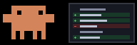
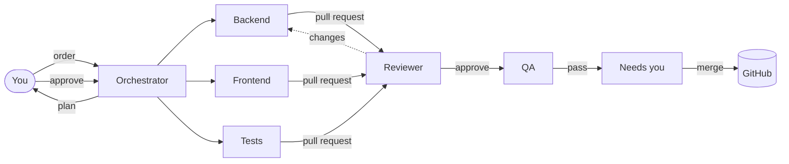
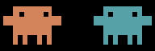
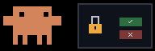

<div align="center">


<br />

**You give the order. They plan, build, review and test it as pull requests. You tap merge.**

[](LICENSE)
[](https://nodejs.org)
[](https://claude.com/claude-code)
[](#phone-access)
[](#platform)

<!-- Owner: replace with the GIF cut from the launch reel. -->


</div>

---

## How it works

<table>
<tr>
<td align="center" width="20%"><br /><b>1. Bring a repo</b></td>
<td align="center" width="20%"><br /><b>2. Approve the plan</b></td>
<td align="center" width="20%"><br /><b>3. Agents build</b></td>
<td align="center" width="20%"><br /><b>4. Review and QA</b></td>
<td align="center" width="20%"><br /><b>5. You merge</b></td>
</tr>
<tr valign="top">
<td>A GitHub repo, a folder, or a blank folder with a product brief. The Onboarding agent interviews you and proposes your office.</td>
<td>Tell the Orchestrator what you want. It splits the work into tasks with dependencies. Approve, edit or reject.</td>
<td>Specialists work in parallel, each in its own git worktree, in real Claude Code terminals you can watch and take over.</td>
<td>A Reviewer and a QA agent check every PR. Failures go back to the author with notes.</td>
<td>Ready PRs land in <i>Needs you</i>. One tap merges each, from anywhere.</td>
</tr>
</table>



## More than a dev team

Tech is always open. Add floors as you need them. Each floor has its own lead, workers and reviewer, writes Markdown under its own folder, and ships PRs the same way code does. Tech, Design and Docs are the well-tried ones; the rest are marked experimental, and onboarding only proposes them when you ask for that kind of work.

| Floor | What it makes |
|---|---|
| **Tech** | The product: code, tests, specs |
| **Design** | UX flows, wireframes, UI specs, HTML mockups, design tokens |
| **Docs** | User guides, help center, API reference, changelogs |
| **Marketing** (experimental) | Positioning, website copy, blog posts, launch drafts |
| **Sales** (experimental) | Ideal customer profile, pitch, outreach drafts |
| **Customer** (experimental) | Onboarding guides, FAQ, support replies |
| **Legal** (experimental) | Terms, privacy policy, compliance checklists (all drafts) |
| **Ops & Finance** (experimental) | Runway and pricing models, budgets, processes |
| **Research** (experimental) | Market and competitor research, interview synthesis |

Plus a **Support desk**  for chores: run the tests, start a dev server, query a database. No plan, no PR.

## What you see

<table>
<tr>
<td width="50%" valign="top">

**Office.** Every agent at a desk, animated by what it is doing right now. Tap one to open its live terminal.

**Command.** Chat with each floor's lead. Plans arrive as cards with a cost estimate; edit the agent, dependencies, files and checks before you approve. Your chat stays open between visits.

**Board.** Kanban of every task, from planned to merged, and a Shipped view with weekly totals.

**Activity.** Everything the office logged, filterable by kind.

</td>
<td width="50%" valign="top">

**Needs you.** Plans to approve, permission prompts, questions and PRs to merge.

**Team.** Hire, pause or remove agents; pick each one's model and effort.

**Vault.** Notes and decisions the whole team can search.

**Keyboard.** `/` jumps to the message box; `g` then `h`, `c`, `n`, `a` or `b` switches tabs.

</td>
</tr>
</table>

Agents also talk to each other: they pass notes, ask the lead questions, and ask you only when the answer changes scope.

<p align="center">




</p>

## Quickstart

You need:

| | |
|---|---|
| **Node 24** | uses the built-in `node:sqlite` |
| **git** | |
| **Claude Code** | logged in. Terminal runs need the native `claude.exe` (or `claude`) on `PATH` from the native installer. With an npm install, set `CREW_CLAUDE_PTY_BIN` to a runnable path, or `CREW_TERMINAL=json` to run headless. |
| **GitHub CLI** | `gh`, logged in with the `repo` scope |
| **A computer that stays on** | agents run on your machine, not in the cloud |

```bash
git clone https://github.com/DewashishCodes/agent-office.git
cd agent-office
npm install
npm run doctor            # checks Node, git, claude, gh and says how to fix what is missing
npm run build && npm start
```

The first start makes an owner token, saves it in `.env` and prints it. Open **http://localhost:5190**, log in with it, and add a project. All state lives in `data/`; delete it to start over.

## Keep it running

Agents run on your computer, so it has to stay on and awake while they work.

| | |
|---|---|
| **Windows** | Run it as a service with [nssm](https://nssm.cc): `nssm install AgentOffice "C:\Program Files
odejs
ode.exe" "--env-file-if-exists=.env" "server\index.js"`, set the app directory to this folder, then `nssm start AgentOffice`. |
| **macOS** | A launchd agent in `~/Library/LaunchAgents` with `KeepAlive` and `WorkingDirectory` set to this folder, running `node --env-file-if-exists=.env server/index.js`. Load it with `launchctl load`. |
| **Linux** | A systemd user unit with `WorkingDirectory` set to this folder, `ExecStart=node --env-file-if-exists=.env server/index.js` and `Restart=on-failure`, then `systemctl --user enable --now`. |
| **Sleep** | Turn off sleep while plugged in, or use `caffeinate -s` (macOS) or PowerToys Awake (Windows). The app shows a one-line notice after the server comes back from a crash, power loss or sleep; interrupted tasks go back in the queue. |

The service must run as your user so it sees your `git`, `claude` and `gh` logins.

A service manager can watch `http://localhost:5190/api/health`. Server output also goes to `data/server.log` (rotated at 10 MB), and Settings has **Download backup** for a snapshot of the database.

## Phone access

Use [Tailscale Serve](https://tailscale.com/kb/1312/serve) for HTTPS inside your private tailnet:

```bash
tailscale serve --bg 5190
```

Open `https://<machine>.<tailnet>.ts.net` on your phone (Tailscale app connected), log in, then **Add to Home Screen** to install the app and turn on push notifications.

- A notification opens its card. Plans and ready PRs carry **Approve** and **Merge** buttons that work from the notification itself.
- The installed app's icon shows how many things wait for you.
- When the PC is off or out of reach, the app still opens and shows the last Needs you list it saw, with a Retry button.

> [!CAUTION]
> Never expose port 5190 to the open internet: no port forwarding, no public tunnels. Anyone who gets in can run commands on your computer through the agents.

## Security

> [!WARNING]
> Agents run real commands on your machine with your git and GitHub credentials. Read this before you start.

| | |
|---|---|
| **Approvals** | Agents edit files in their own worktree freely. Shell commands outside a safe list, or pointed at paths outside the worktree, and file access outside the worktree ask you first. Unanswered requests are denied after 15 minutes. |
| **Deny rules** | Always on: no `git push`, no `gh`, no `.env`, nothing under protected paths (`.env*`, keys, `secrets/`, `.github/workflows/`, `migrations/`). The server does the pushing. |
| **Owned paths** | After each task, a gate checks every changed file against the agent's owned paths and sends the task back if anything is outside. |
| **Merges are yours** | Work arrives as pull requests. The exception is hotfix mode, turned on per order: it skips review and pushes straight to the project branch (never forced). |
| **Autonomous agents** | Turns off an agent's approval prompts (`bypassPermissions`). Only deny rules and the gate remain. Use it only where you accept the risk. |
| **Owner token** | The only login. Keep it long and secret. Failed logins are rate limited; agents never see it. Each login is its own session: Log out ends it, Log out everywhere (menu) ends them all. |
| **Kill switch** | One per project. Stops every session at once. |

These are guardrails against accidents, not a sandbox against a determined model. An agent runs as you, with your git and `gh` credentials, and anything it can run (a test script it just edited, `node`, `make`) can reach whatever you can. The safe list refuses paths outside the worktree, but a program it writes and runs is not checked. Run the crew under a separate OS user or in a VM if that matters for your repo.

## Costs

No backend, no fees. Every session runs on **your own Claude plan** and counts against its usage limits. Pick a model and effort level per agent, and set daily token budgets per project and per agent in Settings; when a budget runs out, no new tasks start until the next day.


The header shows what you spent today and how much of your 5-hour limit is used.
<br clear="left" />

## Platform

Built and tested on **Windows 11**. macOS and Linux are **untested**: the code has paths for them, but nobody has run a full order there yet. Reports and fixes are welcome.

## Development

```bash
npm run dev:server        # API on 5190, restarts on change
npm run dev:web           # Vite on 5191, proxies /api
npm test                  # node:test with a fake claude CLI, no real sessions
```

[`CLAUDE.md`](CLAUDE.md) has the architecture, conventions and gotchas. [`docs/CONTRACTS.md`](docs/CONTRACTS.md) has the module contracts. Design history is in [`docs/history/`](docs/history/).

## Credits

The pixel-art Clawd animations in `web/public/clawd/` are by [CodeChrisB/MyClawd](https://github.com/CodeChrisB/MyClawd), a fan project. Clawd is Anthropic's mascot. `pass-note` and `read-note` were drawn for this app with the MyClawd toolkit. Agent Office is not affiliated with or endorsed by Anthropic. The pixel font Silkscreen (Jason Kottke, The Silkscreen Project Authors) ships in `web/public/fonts/` under the SIL Open Font License 1.1 (`OFL.txt` next to it).

## License

[AGPL-3.0](LICENSE). If you run a modified version for others over a network, you must share its source.
